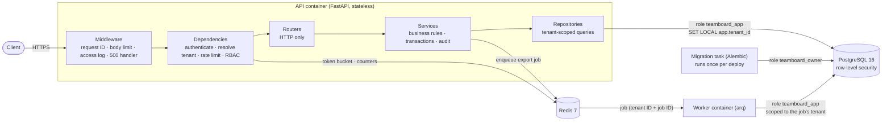
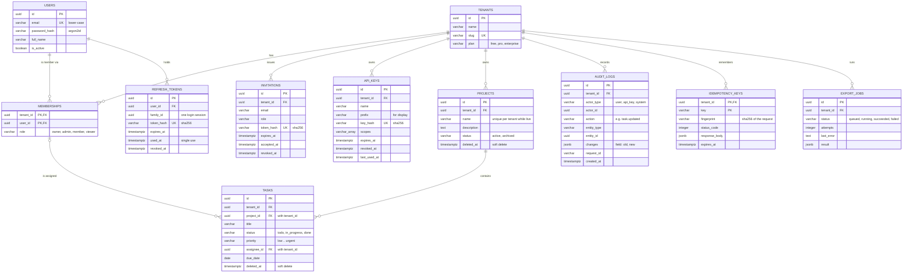

# TeamBoard

A multi-tenant project and task management API - the backend of a small SaaS.
Many organisations ("tenants") share one deployment and one database; the central
engineering problem is that **no tenant can ever read, change or even detect
another tenant's data**. That guarantee is enforced twice, independently, and
proven by tests for every endpoint.

**Stack:** Python 3.12 · FastAPI · SQLAlchemy 2.0 (async) · Alembic · PostgreSQL 16 ·
Redis 7 · pytest on real PostgreSQL/Redis · Docker Compose · GitHub Actions ·
ruff · mypy (strict)

**What is in the box**

- Tenancy with isolation in depth: tenant-scoped repositories **and** PostgreSQL
  row-level security, with a transaction-scoped tenant context that cannot leak
  through the connection pool
- Users in multiple tenants, JWT access tokens, rotating refresh tokens with reuse
  detection, Argon2id password hashing, invitations
- Per-tenant RBAC (owner, admin, member, viewer) and scoped, revocable API keys
- Projects and tasks with filters, cursor pagination, soft delete and an audit log
- Per-tenant rate limiting and plan quotas (Redis), idempotency keys
- A background job with retries (asynchronous data export)
- JSON logs with request and tenant IDs, RFC 7807 errors, health and readiness
  probes, complete OpenAPI documentation
- Multi-stage non-root Docker image, Compose stack, CI, AWS deployment guide

Related documents: [ASSUMPTIONS.md](ASSUMPTIONS.md) (every decision made where the
brief was open) · [docs/deployment-aws.md](docs/deployment-aws.md) ·
[PROGRESS.md](PROGRESS.md) (build log) ·
[ABSCHLUSSBERICHT.md](ABSCHLUSSBERICHT.md) (final report, in German)

---

## Contents

1. [Quick start](#1-quick-start)
2. [Architecture](#2-architecture)
3. [Multi-tenancy model](#3-multi-tenancy-model)
4. [Tenant isolation in depth](#4-tenant-isolation-in-depth)
5. [Data model](#5-data-model)
6. [Authentication and authorization](#6-authentication-and-authorization)
7. [API conventions](#7-api-conventions)
8. [Background jobs](#8-background-jobs)
9. [Operations](#9-operations)
10. [Development and testing](#10-development-and-testing)
11. [Dependencies](#11-dependencies)
12. [Decisions & trade-offs](#12-decisions--trade-offs)
13. [Known limitations](#13-known-limitations)

---

## 1. Quick start

Requirements: Docker with Compose v2.

```bash
docker compose up --build
```

This starts PostgreSQL, Redis, a one-off migration task, the API and the worker.
No configuration is needed for local use (development defaults are built into
`docker-compose.yml`; see `.env.example` to override them).

| What | Where |
|---|---|
| Interactive API docs (Swagger UI) | http://localhost:8000/docs |
| Reference docs (ReDoc) | http://localhost:8000/redoc |
| OpenAPI document | http://localhost:8000/openapi.json |
| Liveness / readiness | http://localhost:8000/healthz · http://localhost:8000/readyz |

A two-minute tour with `curl`:

```bash
API=http://localhost:8000

# 1. Register and log in
curl -s $API/v1/auth/register -H 'Content-Type: application/json' \
  -d '{"email":"ada@example.com","password":"a-long-passphrase","full_name":"Ada"}'
TOKEN=$(curl -s $API/v1/auth/login -H 'Content-Type: application/json' \
  -d '{"email":"ada@example.com","password":"a-long-passphrase"}' \
  | python3 -c 'import json,sys; print(json.load(sys.stdin)["access_token"])')

# 2. Create a tenant - you become its owner
TENANT=$(curl -s $API/v1/tenants -H "Authorization: Bearer $TOKEN" \
  -H 'Content-Type: application/json' -d '{"name":"Acme","slug":"acme"}' \
  | python3 -c 'import json,sys; print(json.load(sys.stdin)["id"])')

# 3. Work inside the tenant: every request names it in X-Tenant-ID
curl -s $API/v1/projects -H "Authorization: Bearer $TOKEN" -H "X-Tenant-ID: $TENANT" \
  -H 'Content-Type: application/json' -H 'Idempotency-Key: demo-1' \
  -d '{"name":"Website relaunch"}'
curl -s $API/v1/projects -H "Authorization: Bearer $TOKEN" -H "X-Tenant-ID: $TENANT"
```

`python3 scripts/smoke_test.py` runs a longer journey against the running stack
(two tenants, tasks, an export through the worker, cross-tenant checks).

---

## 2. Architecture



**One deployable, three processes.** The API, the worker and the migration task
are the same image started with different commands. No microservices, no service
mesh: the system is a modular monolith.

**Layering: routers → services → repositories.**

| Layer | Responsibility | Must not |
|---|---|---|
| `api/routers` | Parse the request, call one service method, shape the response | Contain business rules, import SQLAlchemy, repositories or ORM models |
| `services` | Business rules, authorization details, transactions, audit entries | Know about HTTP (no FastAPI/Starlette imports) |
| `repositories` | Build and run queries | Build a tenant-owned query without the tenant predicate |

These rules are not conventions: `tests/test_architecture.py` parses the source
tree and fails the build when one is broken.

**Life of a tenant-scoped request** (`GET /v1/projects`):

1. *Middleware* assigns a request ID, enforces the body size limit and will write
   the access log line.
2. `get_session` opens one database session (one connection) for the request.
3. `get_principal` verifies the JWT or the API key → *who is calling*.
4. `get_tenant_context` checks the caller's membership in the tenant named by
   `X-Tenant-ID` (or uses the tenant the API key belongs to), then scopes the
   session to that tenant (`app.tenant_id`) and charges the tenant's rate limit.
   Only this step can create a `TenantContext`.
5. `require(Permission.PROJECTS_READ)` checks the role or the key's scopes.
6. The service is built for that tenant context; its repositories are bound to the
   tenant ID from the context - never to anything the client sent.
7. The service commits explicitly, *before* the response is produced, so a
   success response is only sent for durable changes. The session is closed (and
   anything uncommitted rolled back) before the response leaves.

---

## 3. Multi-tenancy model

**Chosen: shared database, shared schema, a `tenant_id` column on every
tenant-owned table.**

| | Shared schema + `tenant_id` (chosen) | Schema per tenant | Database per tenant |
|---|---|---|---|
| Isolation | Logical. A missing filter is a leak - *unless* enforced below the application (here: RLS) | Stronger by default (`search_path`), still one database | Strongest: separate files, credentials, backups |
| Cost per tenant | A few rows | Hundreds of catalog objects | A whole database (connections, memory, storage) |
| Tenants supported | Millions | Thousands (catalog bloat, slow `pg_dump`) | Hundreds |
| Migrations | One, atomic | One per schema; versions drift | One per database; drift, long rollouts |
| Connection pooling | One pool for everyone | Pool per `search_path`, or reset per request | Pool per tenant |
| Cross-tenant analytics | Trivial | `UNION` over schemas | ETL |
| Noisy neighbour | Shared resources; needs rate limits and quotas | Same | Isolated |
| Per-tenant restore / residency | Hard (row-level export) | Possible | Easy |

For a product with many small tenants, shared schema is the only model whose
operating cost does not grow with the number of tenants: one migration, one pool,
one backup. Its one real weakness - isolation depends on every query being
filtered correctly - is exactly what the next section removes by making PostgreSQL
enforce the filter. Schema-per-tenant buys moderately stronger isolation at the
price of operational drag that starts hurting at a few thousand tenants;
database-per-tenant is right when customers pay for physical isolation or data
residency, and wrong as a default.

*Migration path:* because every tenant-owned row carries `tenant_id` and every
foreign key between tenant tables includes it, a large tenant can later be moved
to its own database (or the tables hash-partitioned by `tenant_id`) without
changing the data model.

---

## 4. Tenant isolation in depth

Three independent layers. Each is sufficient on its own; the test suite removes
them one at a time to prove it.

### Layer 1 - application: repositories that cannot omit the filter

Every tenant-owned table is reached only through a subclass of
`TenantScopedRepository` ([repositories/base.py](src/teamboard/repositories/base.py)).

- A repository is constructed with a tenant ID taken from the authorized
  `TenantContext` and is bound to it for life.
- Subclasses never call `select()`, `update()`, `delete()` or `text()`. They start
  from `self._select()`, `self._update()`, … which already contain
  `WHERE tenant_id = :bound_tenant`. There is no code path in a subclass that
  produces a statement without the predicate.
- `add()` stamps the bound tenant on new rows, overwriting whatever the caller set.
- `TenantContext` objects are created in exactly one place
  (`services/access.py`), after authentication and a membership check.

All four statements are enforced by `tests/test_architecture.py`.

### Layer 2 - database: row-level security

Migration [`0002`](migrations/versions/0002_row_level_security.py) enables **and
forces** RLS on *every* table (11 of 11; a test fails if a future table has none).
Policies compare rows with transaction-local settings:

| Tables | Rule |
|---|---|
| `projects`, `tasks`, `export_jobs`, `idempotency_keys` | `tenant_id = app.tenant_id` for all commands |
| `audit_logs` | same, but `SELECT` and `INSERT` only (append-only) |
| `memberships` | tenant rule, plus a user may read their own memberships |
| `api_keys`, `invitations` | tenant rule, plus lookup of the single row whose secret hash the caller presents |
| `tenants` | the current tenant, or tenants the user is a member of; inserts only on the free plan |
| `users` | own row, co-members of the current tenant, lookup by exact login email |
| `refresh_tokens` | own tokens, or the token whose hash is presented |

With no setting present every policy evaluates to `NULL`: **a connection without
context sees zero rows in every table** (fail closed). A malformed setting raises
an error instead of matching anything.

*Pre-tenant lookups without a bypass.* An API key or invitation token identifies
its tenant, so it has to be found before a tenant is known. Instead of a
`BYPASSRLS` role or a `SECURITY DEFINER` function, a narrow policy exposes exactly
the row whose stored SHA-256 hash equals `app.token_hash` - the hash of the secret
the caller presented. Nothing can be listed or scanned that way.

### Why the tenant cannot leak through the connection pool

Connections are pooled and reused across requests, so session state is the classic
leak: request 1 sets a tenant, request 2 inherits it.

- The context is written with `set_config(name, value, is_local => true)` - the
  parameterisable form of `SET LOCAL`. PostgreSQL discards such a value when the
  transaction ends, on `COMMIT` and on `ROLLBACK`. Outside a transaction there is
  no tenant, and without a tenant there are no rows.
- The context is remembered on the *session object* and re-applied by an
  `after_begin` hook whenever that session starts another transaction, so a
  service may commit mid-request without silently losing (or changing) its scope.
- All of this lives in one small module, [db/rls.py](src/teamboard/db/rls.py) -
  the only place in the code base that writes these settings (enforced by test).

Because the scope is per transaction, the design is also compatible with
transaction-mode connection poolers such as PgBouncer.

### Layer 3 - privileges and constraints

- The API and worker connect as **`teamboard_app`**: not a superuser, no
  `BYPASSRLS`, owner of nothing. Migrations run as a separate owner role. At
  startup the application checks its own role and **refuses to start** if it
  would bypass RLS (e.g. `DATABASE_URL` accidentally pointing at the owner).
- Privileges are granted per **column**. The application role can update only the
  columns it legitimately changes - never `tenant_id` (a row cannot change
  tenant), `tenants.plan` (quotas are a billing decision), `users.is_active`, an
  API key's scopes or hash, or anything in the audit log. `DELETE` exists only
  for memberships.
- Foreign keys between tenant tables are **composite and include `tenant_id`**
  (`tasks → projects`, `tasks.assignee → memberships`), so even a role that
  bypasses RLS cannot attach a task to another tenant's project.

### "Cannot detect" - no existence oracles

- Another tenant's object and a non-existent object produce the **same 404**,
  byte for byte (status, headers, body).
- A foreign tenant ID and a non-existent tenant ID produce the same 403.
- Uniqueness is per tenant (project names), so a conflict never reveals another
  tenant's data. Idempotency keys are namespaced per tenant.
- Cross-tenant references in request bodies (e.g. an assignee from another
  tenant) fail exactly like references to nothing.

### What RLS does *not* protect against

RLS here is a guard against **application bugs** - the forgotten filter, the
misused ID. It is not a sandbox for hostile SQL: the application role may set
`app.tenant_id` to any value, so an attacker who can execute arbitrary SQL through
the application has already won. Arbitrary SQL is prevented one level up (bound
parameters everywhere, no string-built SQL).

### How this is proven

| Test module | What it proves |
|---|---|
| [`test_rls.py`](tests/test_rls.py) (73) | Against PostgreSQL directly, as the app role: `SELECT * FROM <table>` **with no filter** returns only the current tenant's rows, for every tenant-owned table; cross-tenant `INSERT`/`UPDATE`/`DELETE` fail; no context ⇒ no rows; column privileges. **Pool leak tests:** on a pool of exactly one connection, the next checkout (same backend PID) has no tenant after commit, after rollback and after an abandoned transaction; 60 interleaved requests for two tenants on two connections never mix |
| [`test_repository_scoping.py`](tests/test_repository_scoping.py) | With a **superuser** session (RLS bypassed), repositories still return only their tenant's rows |
| [`test_cross_tenant.py`](tests/test_cross_tenant.py) (154) | **Every one of the 29 tenant-scoped endpoints**, attacked by tenant A against tenant B: foreign object IDs (as owner, admin, member, viewer and API key), foreign `X-Tenant-ID`, redirected API key, list endpoints and filters. Responses must equal those for non-existent resources and B's data is fingerprinted before and after each attack. A guard test fails when a route is added without a matrix entry |
| [`test_defense_in_depth.py`](tests/test_defense_in_depth.py) | Over HTTP: with RLS removed the application layer still isolates; with the repository filter removed RLS still isolates; with **both** removed tenant A reads tenant B's data - the control experiment showing the tests can see a leak |
| [`test_architecture.py`](tests/test_architecture.py) | The structural rules above |

---

## 5. Data model



Notes:

- **`users` and `refresh_tokens` are global.** A person has one account and joins
  tenants through `memberships`; that is what "users can belong to multiple
  tenants" requires. They carry no `tenant_id` but are still under RLS.
- **Every other table is tenant-owned** and has `tenant_id NOT NULL` with an index
  that starts with it.
- **IDs are random UUIDs** generated by the application: not guessable, not
  enumerable, and known before the insert (which RLS needs when a tenant creates
  its own first rows).
- **Enumerations are `VARCHAR` + `CHECK`**, not native enum types, so adding a
  value is a cheap constraint swap.
- **Soft delete** (`deleted_at`) on projects and tasks. Deleting a project stamps
  its live tasks with the same timestamp; restoring it brings back exactly those.
  The project-name uniqueness index is partial (`WHERE deleted_at IS NULL`).

---

## 6. Authentication and authorization

### Two kinds of callers

| | User | API key |
|---|---|---|
| Credential | `Authorization: Bearer <JWT>` | `X-API-Key: tbk_…` |
| Tenant | Any tenant the user is a member of, chosen per request with `X-Tenant-ID` | Exactly the tenant the key was created in (`X-Tenant-ID` optional; a different value is rejected) |
| Permissions | Those of the user's **role** in that tenant | Exactly the key's **scopes** |
| In the audit log | `user:<id>` | `api_key:<id>` |

### Tokens

- **Access token:** JWT (HS256), 15 minutes, stateless. It identifies the *user
  only* - no tenant, no role. Membership and role are read from the database on
  every request, so removing a member or changing a role takes effect on the next
  request, not when a token expires. The algorithm is pinned (no `alg=none`
  downgrade), `exp`/`iat`/`sub`/`iss` are required.
- **Refresh token:** 256 random bits, 30 days, stored only as a SHA-256 hash,
  **single use**. `POST /v1/auth/refresh` marks it used and issues a successor in
  the same *family* (one family per login).
- **Reuse detection:** presenting an already-used refresh token means two parties
  hold it - the user and a thief, in unknown order. The whole family is revoked
  and the user must log in again. Other devices (other families) are unaffected.
- **Concurrency:** the token row is locked (`SELECT … FOR UPDATE`) during
  rotation. Of N simultaneous requests with the same token exactly one succeeds
  (tested with ten).
- **Passwords:** Argon2id (`argon2-cffi`), hashed off the event loop, 12-128
  characters. Hashes are upgraded transparently at login when the cost parameters
  are raised. Login costs the same whether or not the account exists, and returns
  the same error.
- **Abuse protection:** auth endpoints are rate-limited per client address; an
  account is locked for 15 minutes after 10 failed logins.

### Roles

Ranked `viewer < member < admin < owner`. Each endpoint requires one permission.

| Permission | owner | admin | member | viewer | grantable to API keys |
|---|:-:|:-:|:-:|:-:|:-:|
| `tenant:read`, `members:read`, `projects:read`, `tasks:read` | ✓ | ✓ | ✓ | ✓ | ✓ |
| `projects:write`, `tasks:write` | ✓ | ✓ | ✓ | | ✓ |
| `projects:delete`, `audit:read`, `exports:manage` | ✓ | ✓ | | | ✓ |
| `tenant:write`, `members:manage`, `invitations:manage`, `api_keys:manage` | ✓ | ✓ | | | never |

What distinguishes an **owner** from an admin is rank, not permissions: you cannot
modify a member who outranks you, nor grant a role above your own - so only an
owner can create or demote owners - and a tenant always keeps at least one owner
(enforced under a lock; two owners demoting each other concurrently cannot both
succeed). Anyone may leave a tenant themselves.

### API keys

`tbk_` + 256 random bits. The key is returned **once**, in the creation response;
the database stores a SHA-256 hash and a 12-character prefix for identification.
(A fast hash is correct here: unlike a password, the input has too much entropy to
brute-force, and a deterministic digest allows an indexed lookup.) Keys carry
explicit scopes, can never hold administrative permissions, can expire, and are
revoked immediately - there is nothing to cache or wait for.

### Invitations

An admin invites an email address with a role and receives a one-time token
(stored hashed, valid 7 days). The invitee accepts with their own account, and the
account's email must match the invitation - a leaked token is useless to anyone
else. Ownership cannot be granted by invitation.

---

## 7. API conventions

**Versioning.** All resource routes live under `/v1`.

**Errors - RFC 7807.** Every error, from validation failures to unexpected
exceptions, is `application/problem+json`:

```json
{
  "type": "urn:teamboard:problem:not_found",
  "title": "Not Found",
  "status": 404,
  "detail": "Project not found.",
  "instance": "/v1/projects/7b0c5d4e-3a53-4c0f-9f2b-0e9d7c1a2b3c",
  "code": "not_found",
  "request_id": "0c3f1a6e5b7d4e8f9a1b2c3d4e5f6a7b"
}
```

`code` is a stable machine-readable identifier; validation errors add an `errors`
list (`field`, `message`, `type`) that never echoes submitted values. A 500
contains nothing but a generic message and the request ID.

**Pagination - cursors.** List endpoints take `limit` (1-100, default 20) and
`cursor`, and return `{"items": [...], "next_cursor": "…" | null}`. Results are
ordered newest first by `(created_at, id)`; the cursor is the position of the last
item (keyset pagination). Pages therefore stay correct while rows are inserted and
cost the same at any depth, unlike `OFFSET`.

**Idempotency.** `POST /v1/projects`, `POST /v1/projects/{id}/tasks` and
`POST /v1/exports` accept an `Idempotency-Key` header. A retry with the same key
returns the original response with `Idempotent-Replayed: true` and creates
nothing. The key is inserted into `idempotency_keys` (primary key
`(tenant_id, key)`) **in the same transaction** as the operation, together with
the response. Consequences:

- record and effect commit atomically - there is no window in which one exists
  without the other;
- two simultaneous requests with one key serialise on the primary key inside
  PostgreSQL: one executes, the others wait and replay (tested with ten);
- a failed request leaves no record, so the key can be retried;
- reusing a key for a different request, operation or caller is a `422`;
- keys are per tenant and expire after 24 hours.

Endpoints that return a secret (API keys, invitations) deliberately do not support
replay, because that would require storing the secret.

**Rate limits and quotas.**

| Limit | Free | Pro | Enterprise | Enforced by | On excess |
|---|--:|--:|--:|---|---|
| Requests per minute, per tenant | 120 | 1 200 | 6 000 | Redis token bucket (Lua) | `429` + `Retry-After` |
| Exports per day | 5 | 100 | 1 000 | Redis counter (Lua) | `429` + `Retry-After` |
| Projects | 5 | 200 | 5 000 | Row count under a per-tenant advisory lock | `403 project_quota_exceeded` |
| Members | 5 | 50 | 1 000 | same | `403 member_quota_exceeded` |
| Active API keys | 2 | 20 | 100 | same | `403 api_key_quota_exceeded` |

Responses carry `RateLimit-Limit` and `RateLimit-Remaining`. The budget belongs to
the tenant (all users and keys share it) and is only charged *after*
authorization, so strangers cannot exhaust it. `GET /v1/tenants/current/usage`
shows limits and consumption. If Redis is down or slow the limiters **fail open**.

**Audit log.** Every state change writes an entry - actor, action, entity, a
`{field: {old, new}}` diff, request ID, timestamp - *in the same transaction* as
the change. No change without a record, no record of a change that was rolled
back. The application role can only `SELECT` and `INSERT` on the table.

**Other.** Unknown fields in a request body are rejected (`422`). Bodies above
1 MiB are rejected (`413`). Responses carry `Cache-Control: no-store`,
`X-Content-Type-Options: nosniff` and `X-Request-ID`.

---

## 8. Background jobs

`POST /v1/exports` answers `202 Accepted` with a job; a worker builds a JSON
document of the tenant's projects and tasks; the client polls
`GET /v1/exports/{id}` and fetches `/download`.

- **State lives in PostgreSQL** (`export_jobs`: status, attempts, last error,
  result). Redis only transports "work on job X of tenant Y".
- **No lost jobs.** The API enqueues *before* it commits. If queueing fails the
  request fails and the row is rolled back, so a committed job always has a queue
  entry. The opposite case (queue entry, row not yet or never committed) is
  handled by the worker: it retries briefly, then drops the message.
- **Retries.** A failing attempt is recorded on the row and retried with
  exponential backoff (5 s, 10 s, 20 s, …) up to `EXPORT_MAX_ATTEMPTS` (4), after
  which the job is `failed`. The row is always truthful: `queued` while a retry is
  pending, never stuck in `running` after an error.
- **At-least-once, idempotent.** Re-delivery of a finished job does nothing.
- **Tenant isolation in the worker.** The worker uses the same restricted
  database role as the API and scopes its session to the job's tenant before the
  first query. A message naming tenant A and a job of tenant B does nothing.
- **Payloads are JSON, not pickle**, so write access to Redis cannot become code
  execution in the worker.

---

## 9. Operations

### Configuration

Environment variables only (12-factor); `.env.example` lists them.

| Variable | Default | Purpose |
|---|---|---|
| `DATABASE_URL` | *required* | Runtime connection, **restricted role** (`postgresql+asyncpg://…`) |
| `MIGRATION_DATABASE_URL` | *required for Alembic* | Owner role; used only by `alembic` |
| `APP_DB_ROLE` | `teamboard_app` | Role the migrations grant privileges to |
| `REDIS_URL` | *required* | Rate limits, quotas, job queue |
| `JWT_SECRET` | *required* | ≥ 32 characters; the development placeholder is refused when `ENVIRONMENT=production` |
| `ENVIRONMENT` | `development` | `development`, `test`, `production` |
| `LOG_LEVEL` | `INFO` | |
| `DOCS_ENABLED` | `true` | Serve `/docs`, `/redoc`, `/openapi.json` |
| `FORWARDED_ALLOW_IPS` | `127.0.0.1` | Proxies whose `X-Forwarded-For` is trusted (needed for per-client limits behind a load balancer) |
| `MAX_REQUEST_BODY_BYTES` | `1048576` | |
| `ACCESS_TOKEN_TTL_SECONDS` / `REFRESH_TOKEN_TTL_SECONDS` | `900` / `2592000` | |
| `DB_POOL_SIZE` / `DB_MAX_OVERFLOW` / `DB_STATEMENT_TIMEOUT_MS` | `10` / `10` / `30000` | |
| `ARGON2_TIME_COST` / `ARGON2_MEMORY_COST_KIB` / `ARGON2_PARALLELISM` | `3` / `65536` / `4` | |
| `AUTH_RATE_LIMIT_PER_MINUTE`, `LOGIN_FAILURE_LIMIT`, `LOGIN_FAILURE_WINDOW_SECONDS` | `30`, `10`, `900` | |
| `EXPORT_MAX_ATTEMPTS` / `EXPORT_RETRY_BASE_SECONDS` | `4` / `5.0` | |
| `INVITATION_TTL_SECONDS` / `IDEMPOTENCY_TTL_SECONDS` | `604800` / `86400` | |
| `HOST` / `PORT` / `JWT_ISSUER` | `0.0.0.0` / `8000` / `teamboard` | |

Secrets (`JWT_SECRET` and both connection strings) are masked wherever the
settings object could be printed. Nothing secret is committed: the defaults in
`docker-compose.yml` are public development placeholders.

### Database roles

| Role | Used by | Rights |
|---|---|---|
| owner (e.g. `teamboard_owner`) | `alembic upgrade head` only | Owns the schema |
| `teamboard_app` | API and worker | Column-level DML, subject to RLS; no DDL |

Creating login roles is an infrastructure task, not a migration (passwords do not
belong in migration files). Compose does it in
`docker/postgres/init/01-create-app-role.sh`; elsewhere:

```sql
CREATE ROLE teamboard_app LOGIN PASSWORD '…'
    NOSUPERUSER NOCREATEDB NOCREATEROLE NOBYPASSRLS;
```

The migration fails with a clear message if the role does not exist.

### Logging

One JSON object per line on stdout; every line carries `request_id`, `tenant_id`
and `actor`:

```json
{"timestamp": "2026-11-14T10:20:43.862113+00:00", "level": "INFO", "logger": "teamboard.access",
 "message": "request completed", "request_id": "8dd7457a1b5c452590dc1e0f6a04a66c",
 "tenant_id": "0ac19cac-ecf7-41ab-be75-5ae2cf89b4d8", "actor": "user:e33e290a-547d-46ee-b992-0776ef56cf63",
 "method": "POST", "path": "/v1/projects", "status": 201, "duration_ms": 9.31, "client_ip": "192.168.65.1"}
```

A client-supplied `X-Request-ID` is propagated if it matches a conservative
pattern, otherwise replaced. Credentials, request bodies and query strings are
never logged.

### Health

| Endpoint | Meaning | Use for |
|---|---|---|
| `GET /healthz` | Process is up. Touches no dependency. | Liveness / container health check |
| `GET /readyz` | PostgreSQL and Redis reachable (`503` otherwise) | Readiness / load balancer |
| `python -m teamboard.worker --check` | A worker heartbeat exists in Redis | Worker container health check |

---

## 10. Development and testing

Requirements: Python 3.12 and a running Docker daemon (the tests start their own
PostgreSQL and Redis containers).

```bash
make install     # virtualenv + pinned dependencies (constraints.txt)
make check       # everything CI runs: ruff, mypy --strict, pytest with coverage
make up          # docker compose up --build --detach --wait
make smoke       # end-to-end smoke test against the running stack
make down        # stop and delete data
```

Without `make`:

```bash
python3.12 -m venv .venv
.venv/bin/pip install --constraint constraints.txt --editable ".[dev]"
.venv/bin/ruff format --check . && .venv/bin/ruff check . && .venv/bin/mypy
.venv/bin/python -m pytest --cov
```

Migrations:

```bash
export MIGRATION_DATABASE_URL=postgresql+asyncpg://teamboard_owner:…@localhost:5432/teamboard
alembic upgrade head                      # apply
alembic upgrade head --sql                # print the SQL instead (for review)
alembic revision --autogenerate -m "…"    # new migration; then add RLS + grants by hand
alembic check                             # models and migrations in sync?
```

A new tenant-owned table needs four things, each of which a test demands: the
`TenantOwnedMixin`, a `TenantScopedRepository` subclass, RLS policies plus grants
in its migration, and an entry in the cross-tenant matrix for each new route.

### Tests

**529 tests, 98 % line and branch coverage**, about a minute on a laptop.

- **Real infrastructure.** PostgreSQL 16 and Redis 7 run in containers
  (testcontainers). The schema is created by the real Alembic migrations as the
  owner role and the application connects as the restricted role - the production
  split - so RLS is in force during every test. Nothing at the database boundary
  is mocked; there is no SQLite.
- **In-process HTTP.** Requests go through the complete ASGI stack with `httpx`.
- **No cleanup between tests.** Each test creates its own users and tenants;
  tenant isolation is what keeps tests apart.
- **Concurrency tests** use real parallel connections: refresh-token rotation,
  idempotency keys, project quota, invitation acceptance and creation, the
  last-owner invariant, the token bucket, and two tenants interleaved on a tiny
  connection pool.

| Area | Module (tests) |
|---|---|
| Isolation | `test_rls` (73), `test_cross_tenant` (154), `test_repository_scoping` (6), `test_defense_in_depth` (3), `test_architecture` (9) |
| Auth | `test_auth` (33), `test_api_keys` (22), `test_invitations` (17) |
| Tenancy and RBAC | `test_tenants` (18), `test_members` (16, incl. the full role × endpoint matrix) |
| Domain | `test_projects` (18), `test_tasks` (19), `test_pagination` (17), `test_audit` (11) |
| Reliability | `test_idempotency` (14), `test_rate_limit` (13), `test_exports` (19) |
| Platform | `test_errors_and_logging` (24), `test_openapi` (11), `test_migrations` (11), `test_health` (5), `test_units` (16) |

### CI

[`.github/workflows/ci.yml`](.github/workflows/ci.yml) runs four jobs on every push
and pull request: **lint** (ruff format + check), **type check** (mypy strict),
**tests** (with coverage, on real PostgreSQL/Redis), and **docker** (builds the
image, starts the Compose stack, checks the container is not root, runs the smoke
test).

### Project layout

```
src/teamboard/
  main.py              application factory, router registry, OpenAPI tweaks
  config.py            settings (environment variables)
  domain.py            roles, permissions, plans, principals, TenantContext
  errors.py            domain errors (rendered as RFC 7807 by api/problems.py)
  pagination.py        cursor encoding
  api/                 middleware, dependencies (auth wiring), routers
  services/            business logic - one module per area
  repositories/        data access; base.py holds the tenant scoping
  db/                  models, engine, rls.py (transaction-scoped tenant context)
  security/            argon2 passwords, JWT and opaque tokens
  infra/               Redis: rate limiter, counters, job queue producer
  worker/              arq worker: export job with retries
migrations/versions/   0001 schema · 0002 row-level security, policies, grants
tests/                 see table above
docker/, Dockerfile, docker-compose.yml, .github/workflows/ci.yml
```

---

## 11. Dependencies

Exact versions are pinned in `constraints.txt`.

**Runtime**

| Package | Why it is here |
|---|---|
| `fastapi` | The web framework required by the brief; gives typed request validation and generated OpenAPI docs. |
| `uvicorn[standard]` | The ASGI server that runs FastAPI; the `standard` extra adds `uvloop` and `httptools` for throughput. |
| `sqlalchemy[asyncio]` | ORM and query builder (2.0 style, async); its typed mappings and session events are what the tenant-scoped repositories and the RLS hook are built on. |
| `asyncpg` | The asyncio PostgreSQL driver SQLAlchemy talks through. |
| `alembic` | Versioned schema migrations, including the RLS policies and grants. |
| `pydantic[email]` | Request/response schemas; the `email` extra validates email addresses properly. |
| `pydantic-settings` | Typed, validated configuration from environment variables. |
| `argon2-cffi` | Argon2id password hashing, as required. |
| `pyjwt` | Signing and verifying JWT access tokens. |
| `redis` | Async Redis client for the rate limiter and usage counters. |
| `arq` | Small asyncio-native Redis job queue with retries, for the background export - far lighter than Celery for one job type. |

**Development**

| Package | Why it is here |
|---|---|
| `pytest` | Test runner. |
| `pytest-asyncio` | Runs `async` tests and fixtures on one event loop. |
| `pytest-cov` | Coverage measurement and the 90 % gate. |
| `httpx` | Drives the application in-process over ASGI in tests. |
| `testcontainers[postgres,redis]` | Starts real PostgreSQL and Redis for the test session. |
| `ruff` | Linter and formatter (one tool instead of flake8 + isort + black + bandit). |
| `mypy` | Static type checking in strict mode. |

Deliberately **not** used: a logging library (a 30-line JSON formatter on the
standard library is enough), a rate-limiting library (two Lua scripts), an
authentication framework, Celery, Kubernetes, a second service.

---

## 12. Decisions & trade-offs

| Decision | Why | What it costs |
|---|---|---|
| Shared schema with `tenant_id` | Cost and operations independent of tenant count ([section 3](#3-multi-tenancy-model)) | Isolation is logical → backed by RLS; per-tenant restore is hard |
| RLS **and** repository scoping | Either layer can have a bug without a breach; each is tested without the other | Every new table needs policies; a little duplication |
| `SET LOCAL` per transaction (not `SET` per connection, not a role per tenant) | Cannot leak through the pool by construction; works behind transaction poolers | One extra round trip per transaction |
| `FORCE ROW LEVEL SECURITY` + separate owner role + startup check | A misconfigured `DATABASE_URL` fails loudly instead of silently disabling isolation | Data migrations must set a tenant context or run with a privileged role |
| Secret-hash lookup policies instead of `BYPASSRLS`/`SECURITY DEFINER` | No code path that sees all tenants | Three extra policies to understand |
| Column-level `UPDATE` grants | Plan, tenant and identity columns are immutable for the app even inside a tenant | Grants must be extended when a column becomes editable |
| Tenant from `X-Tenant-ID`, not from the URL or the token | One token works for all of a user's tenants; URLs stay short; role changes are immediate | Clients must send a header; membership is read on every request |
| Stateless 15-minute JWT + stateful refresh tokens | No token store lookup for normal requests, yet sessions are revocable | An access token cannot be revoked individually before it expires |
| Strict refresh reuse detection, no grace period | Simplest rule that is safe under theft | A client that double-submits a refresh loses its session |
| SHA-256 (not Argon2) for API keys and tokens | 256-bit secrets need no slow hash; allows indexed lookup | None for random secrets |
| Explicit commit in services | The response is sent only after the commit; commit errors reach the client | A service method that forgets to commit loses its work (caught by tests) |
| Idempotency record in the business transaction | Atomic, and correct under concurrency without extra locks | Only successful responses are replayed; 24 h of rows per key |
| Count-based quotas under an advisory lock | Exact under concurrency, no counter to keep in sync | Serialises creations per tenant (short) |
| Rate limiter fails open | A Redis outage should not be an API outage | No throttling during the outage |
| Same 404 for foreign and missing objects; 403 for foreign and missing tenants | No existence oracle | Less specific errors for honest mistakes |
| Enqueue before commit | A committed job can never be missing from the queue | The worker must tolerate a message without a row |
| Export result stored in PostgreSQL | No object store needed to run the project | Not suitable for very large tenants (see limitations) |
| arq instead of Celery or a hand-written queue | Asyncio-native, a few hundred lines, retries built in | In maintenance mode upstream; fewer features |
| Text enums + `CHECK`, application-generated UUIDs | Cheap to evolve; IDs known before insert | UUIDv4 indexes are not time-ordered |
| No Kubernetes, no microservices, no IaC in the repo | The brief asks for no over-engineering; one image, three commands | The AWS guide is prose, not Terraform |

---

## 13. Known limitations

- **CI has not run on GitHub.** The repository has no remote. Every command in the
  workflow was executed locally (including the Compose smoke test), and the
  workflow file was parsed and checked structurally, but not executed by Actions
  and not linted with `actionlint`.
- **Access tokens cannot be revoked individually** before they expire (15 min).
  Disabling a user, removing a membership and revoking a refresh-token family all
  take effect immediately.
- **Account lockout can be abused** to lock a known email out for 15 minutes.
  Registration reveals whether an email is taken (`409`).
- **No email delivery.** Invitation tokens are returned to the inviter; there is
  no verification of email ownership at registration and no password reset.
- **Export results live in PostgreSQL** as one JSONB document. Large tenants need
  streaming to object storage (S3) with a pre-signed download.
- **No retention jobs.** Expired idempotency keys, used refresh tokens and
  soft-deleted rows are not purged (an expired idempotency key is overwritten on
  reuse). A purge needs a privileged role by design.
- **Plans are changed in the database**, not through an API; there is no billing.
  Tenants cannot be deleted through the API.
- **API keys belong to the tenant.** Removing the member who created a key does
  not revoke it.
- **One signing secret.** Rotating `JWT_SECRET` invalidates all access tokens;
  there is no key-ID based rotation.
- **Unauthenticated traffic** outside the auth endpoints is not rate-limited by
  the application; that belongs to the load balancer / WAF.
- **A worker killed hard on the final attempt** can leave a job in `running`;
  there is no reaper for stuck jobs.
- Fixed sort order (newest first) on all lists; no CORS configuration (API-only).
