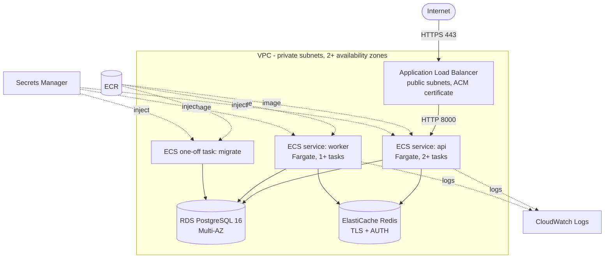

# Deploying TeamBoard on AWS

A reference deployment on managed services: **ECS on Fargate** for the containers,
**RDS for PostgreSQL 16**, **ElastiCache for Redis**, an **Application Load
Balancer**, **Secrets Manager** and **CloudWatch Logs**. No Kubernetes.

> **Status of this guide.** It describes the target setup and the
> application-specific requirements. It was written without access to an AWS
> account and has **not been executed**; treat the AWS CLI snippets as a starting
> point and check them against current AWS documentation. Everything that concerns
> the application itself (roles, environment variables, health checks, migration
> order) is verified by the test suite and the local Compose stack.

## 1. Target architecture



One image, three task definitions that differ only in command and secrets:

| Task | Command | Database role |
|---|---|---|
| `api` | `python -m teamboard` (image default) | `teamboard_app` |
| `worker` | `python -m teamboard.worker` | `teamboard_app` |
| `migrate` | `alembic upgrade head` | owner role |

## 2. Network

- A VPC with public and private subnets in at least two availability zones.
- ALB in the public subnets; **everything else in private subnets**.
- Security groups, each admitting only what it needs:

  | Security group | Inbound |
  |---|---|
  | `alb` | 443 from the internet |
  | `api` | 8000 from `alb` |
  | `worker`, `migrate` | none |
  | `rds` | 5432 from `api`, `worker`, `migrate` |
  | `redis` | 6379 from `api`, `worker` |

- Outbound access to ECR, Secrets Manager and CloudWatch through VPC endpoints or
  a NAT gateway.

## 3. Data stores

### RDS for PostgreSQL 16

- Multi-AZ, storage encryption on, automated backups with point-in-time recovery,
  deletion protection, not publicly accessible.
- Require TLS (`rds.force_ssl = 1` in the parameter group) and append
  `?ssl=require` to the connection URLs.

**Create the two database roles once**, connected as the RDS master user. This is
the part that makes tenant isolation work, so do it exactly:

```sql
-- Owner of the schema: used only by the migration task.
CREATE ROLE teamboard_owner LOGIN PASSWORD '<from Secrets Manager>';
GRANT ALL ON DATABASE teamboard TO teamboard_owner;
GRANT ALL ON SCHEMA public TO teamboard_owner;     -- run while connected to "teamboard"

-- Runtime role: used by the API and the worker.
CREATE ROLE teamboard_app LOGIN PASSWORD '<from Secrets Manager>'
    NOSUPERUSER NOCREATEDB NOCREATEROLE NOBYPASSRLS;
```

Then verify - **neither role may bypass row-level security**:

```sql
SELECT rolname, rolsuper, rolbypassrls
FROM pg_roles WHERE rolname IN ('teamboard_owner', 'teamboard_app');
-- expected: both columns false for both roles
```

Notes:

- Do **not** run the application as the RDS master user or as the owner role. The
  application checks its own role at start-up and exits with
  `UnsafeDatabaseRoleError` if that role is a superuser or has `BYPASSRLS`; the
  worker does the same.
- Tables use `FORCE ROW LEVEL SECURITY`, so the owner role is subject to the
  policies too. Schema migrations are unaffected. A future *data* migration must
  either set `app.tenant_id` per tenant or be run by a role you deliberately grant
  `BYPASSRLS` for that purpose.
- Size `max_connections` for
  `(DB_POOL_SIZE + DB_MAX_OVERFLOW) × (api tasks + worker tasks)` plus headroom.
  With the defaults that is 20 connections per task.
- **Connection poolers.** The tenant context is transaction-scoped
  (`set_config(..., is_local => true)`), which is the property a transaction-mode
  pooler needs. With PgBouncer in transaction mode the driver's prepared-statement
  caching must additionally be disabled (see the SQLAlchemy documentation for the
  asyncpg dialect). Neither PgBouncer nor RDS Proxy has been tested with this
  application; with RDS Proxy, verify that connections are not pinned.

### ElastiCache for Redis

- Redis 7, in-transit encryption and an AUTH token; at least one replica with
  automatic failover.
- Use a `rediss://` URL: `rediss://:<auth-token>@<primary-endpoint>:6379/0`.
- Redis holds rate-limit buckets, usage counters and the job queue. Job *state* is
  in PostgreSQL, so losing Redis loses only queue entries for exports that were
  requested but not yet started (they stay `queued`; request them again).
- Treat write access to Redis as privileged: it can trigger exports for any
  tenant (it cannot run code in the worker - payloads are JSON, not pickle).

## 4. Secrets and configuration

Store in **Secrets Manager** and inject through the `secrets` section of the task
definitions (never as plain `environment` entries, never baked into the image):

| Secret | Used by | Value |
|---|---|---|
| `JWT_SECRET` | api | ≥ 32 random characters, e.g. `openssl rand -base64 48` |
| `DATABASE_URL` | api, worker | `postgresql+asyncpg://teamboard_app:<password>@<rds-endpoint>:5432/teamboard?ssl=require` |
| `MIGRATION_DATABASE_URL` | migrate | `postgresql+asyncpg://teamboard_owner:<password>@<rds-endpoint>:5432/teamboard?ssl=require` |
| `REDIS_URL` | api, worker | `rediss://:<auth-token>@<redis-endpoint>:6379/0` |

Plain environment variables:

| Variable | Value | Why |
|---|---|---|
| `ENVIRONMENT` | `production` | Refuses the development JWT secret |
| `FORWARDED_ALLOW_IPS` | `*` | See below |
| `DOCS_ENABLED` | `false` unless the docs should be public | |
| `LOG_LEVEL` | `INFO` | |
| `APP_DB_ROLE` | `teamboard_app` (migrate task only) | Role the migrations grant privileges to |

**`FORWARDED_ALLOW_IPS` matters.** Behind the ALB the TCP peer of every request is
the load balancer. Unless the application trusts the ALB's `X-Forwarded-For`
header, all clients appear to share one address and the per-client limit on the
auth endpoints (30 requests per minute) applies to *everyone together*. Setting
`*` is safe here because the `api` security group admits traffic only from the
ALB.

IAM: the **task execution role** needs to pull from ECR, write to CloudWatch Logs
and read exactly the secrets above. The **task role** needs no AWS permissions at
all - the application calls no AWS API.

## 5. Build and push the image

```bash
AWS_REGION=eu-central-1
ACCOUNT=$(aws sts get-caller-identity --query Account --output text)
REPO=$ACCOUNT.dkr.ecr.$AWS_REGION.amazonaws.com/teamboard
TAG=$(git rev-parse --short HEAD)

aws ecr create-repository --repository-name teamboard --image-scanning-configuration scanOnPush=true
aws ecr get-login-password | docker login --username AWS --password-stdin "$REPO"
docker build --platform linux/amd64 -t "$REPO:$TAG" .
docker push "$REPO:$TAG"
```

Deploy immutable tags (the commit hash), not `latest`. The image is multi-stage,
runs as UID 10001 and contains no build tools.

## 6. Task definitions

Common to all three: Fargate, `awsvpc` networking, the image above, the `awslogs`
log driver, `readonlyRootFilesystem: true` (the application writes nothing to
disk; the Compose stack runs the same way), no added Linux capabilities.

| | api | worker | migrate |
|---|---|---|---|
| Command | *(default)* | `python -m teamboard.worker` | `alembic upgrade head` |
| Size (starting point) | 0.5 vCPU / 1 GB | 0.5 vCPU / 1 GB | 0.25 vCPU / 0.5 GB |
| Port | 8000 | - | - |
| Container health check | `python -c "import sys,urllib.request; sys.exit(urllib.request.urlopen('http://127.0.0.1:8000/healthz', timeout=2).status != 200)"` | `python -m teamboard.worker --check` | - |
| `stopTimeout` | 30 s | 45 s (the worker gives running exports 30 s to finish) | - |

ECS does not use the `HEALTHCHECK` instruction from the Dockerfile; the health
check must be declared in the task definition as above. Argon2 hashing uses 64 MiB
per concurrent login, so do not size the API task below 1 GB.

## 7. Load balancer

- HTTPS listener with an ACM certificate; redirect HTTP to HTTPS; a current TLS
  security policy.
- Target group: target type `ip`, port 8000, **health check path `/readyz`**
  (returns 503 when the instance cannot reach PostgreSQL or Redis), matcher `200`.
- Deregistration delay around 30 s; idle timeout 60 s.
- Recommended: AWS WAF on the ALB with a rate-based rule. The application
  rate-limits per tenant *after* authentication and per client on the auth
  endpoints; anonymous floods on other paths are the WAF's job.

## 8. Deployment sequence

Run in this order on every release:

1. **Build and push** the image (section 5).
2. **Migrate** - run the `migrate` task once and wait for exit code 0:

   ```bash
   aws ecs run-task --cluster teamboard --launch-type FARGATE \
     --task-definition teamboard-migrate \
     --network-configuration 'awsvpcConfiguration={subnets=[...],securityGroups=[...]}'
   ```

   Stop the release if it fails; nothing has changed for running services.
3. **Roll out `api` and `worker`** with the new task definition revision
   (rolling update, minimum healthy 100 %, maximum 200 %, deployment circuit
   breaker with rollback enabled).
4. **Verify** with the smoke test:
   `python3 scripts/smoke_test.py https://api.example.com`
   (it creates two throwaway tenants; needs `DOCS_ENABLED=true`).

Because old and new tasks overlap during step 3, migrations must be
backwards-compatible with the previous release (add columns first, remove them a
release later).

## 9. Scaling and availability

- **API** is stateless: run at least two tasks in different availability zones;
  target tracking on CPU (60 %) or ALB requests per target.
- **Worker:** at least one task. Scale on queue depth by publishing
  `ZCARD arq:queue` as a custom CloudWatch metric. Several workers may run
  concurrently; a job is processed by one of them and re-delivered if that one
  dies.
- **PostgreSQL** is the scaling limit of the shared-schema model. The order of
  measures: larger instance → read replicas for reporting → partition the large
  tables by `tenant_id` → move the largest tenants to their own database (every
  tenant-owned row already carries `tenant_id`).
- **Redis outage:** rate limiting fails open, exports cannot be requested (503),
  `/readyz` reports unavailable.

## 10. Observability

- Logs are JSON on stdout, one object per line, with `request_id`, `tenant_id` and
  `actor` on every line; send them to CloudWatch Logs with the `awslogs` driver.
  Example query in Logs Insights - slowest requests of one tenant:

  ```
  fields @timestamp, method, path, status, duration_ms, request_id
  | filter logger = "teamboard.access" and tenant_id = "<tenant-id>"
  | sort duration_ms desc | limit 20
  ```

- Alarms worth having from day one: ALB 5xx rate and target response time;
  unhealthy host count; RDS CPU, free storage and connection count; ElastiCache
  memory and evictions; queue depth; a metric filter on
  `"refresh token reuse detected"` (possible credential theft) and on
  `level = "ERROR"`.
- Every response carries `X-Request-ID`, and every error body repeats it, so a
  user report can be matched to its log lines.

## 11. Security checklist

- [ ] Application and worker connect as `teamboard_app`; the verification query in
      section 3 shows `false`/`false`.
- [ ] `ENVIRONMENT=production` and a unique `JWT_SECRET` from Secrets Manager.
- [ ] No secret in task definition `environment`, in the image or in the repository.
- [ ] RDS and ElastiCache are in private subnets, encrypted at rest and in transit.
- [ ] Security groups as in section 2; `FORWARDED_ALLOW_IPS=*` only because the
      API accepts traffic from the ALB alone.
- [ ] `DOCS_ENABLED=false`, or a conscious decision to publish the API docs.
- [ ] RDS backups with point-in-time recovery; a restore has been rehearsed.
- [ ] ECR scan-on-push enabled; images deployed by immutable tag.

## 12. Deliberately not included

Terraform/CloudFormation, Kubernetes, multi-region, blue/green tooling and a CDN.
The setup above is the smallest one that is highly available within a region;
infrastructure-as-code for it is the natural next step once an AWS account
exists to validate it against.
